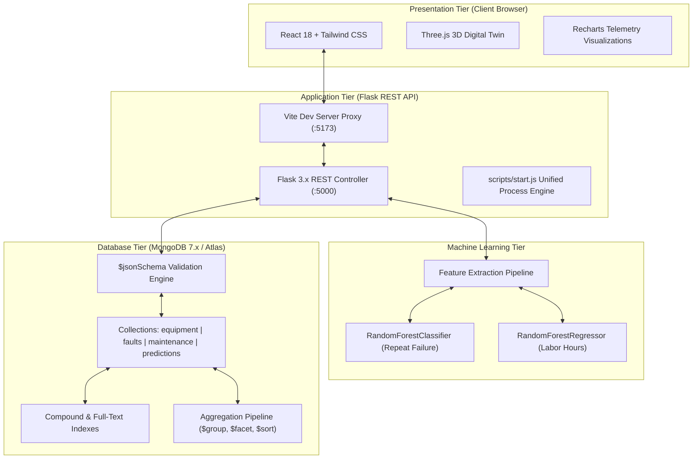
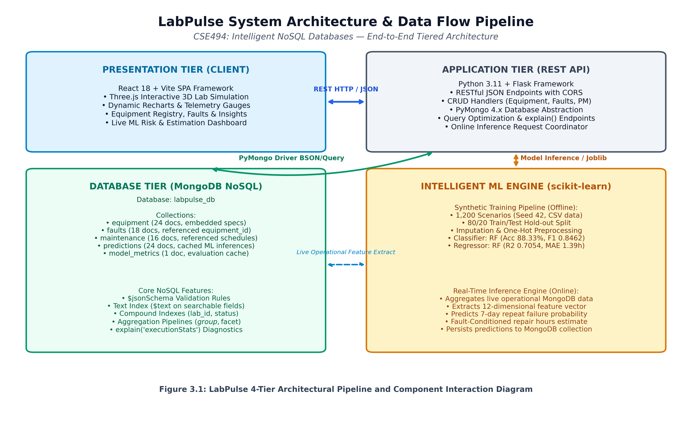
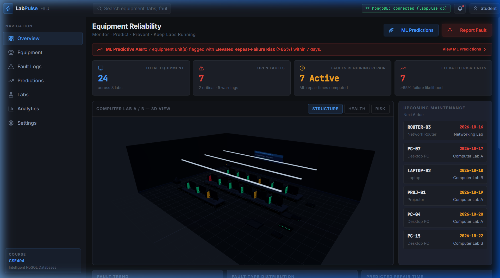
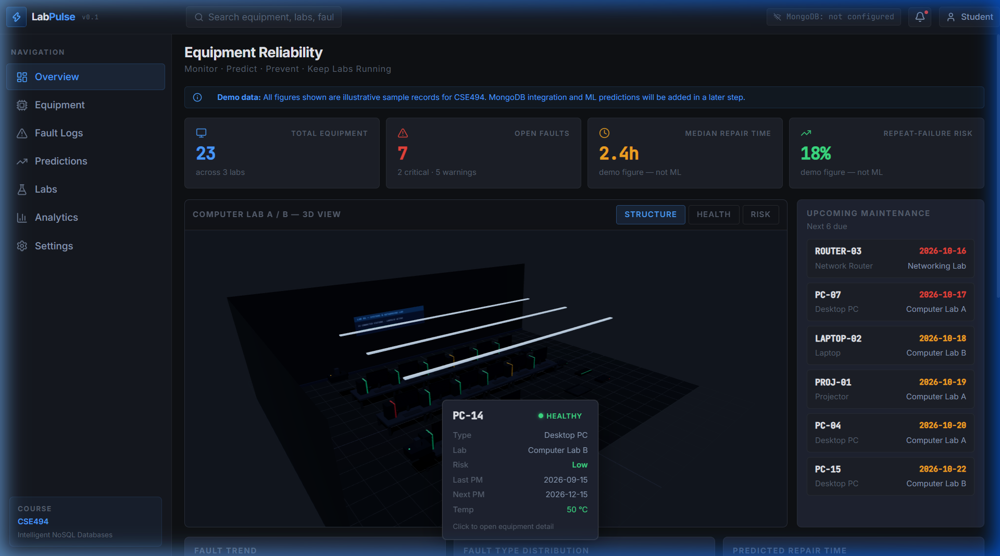
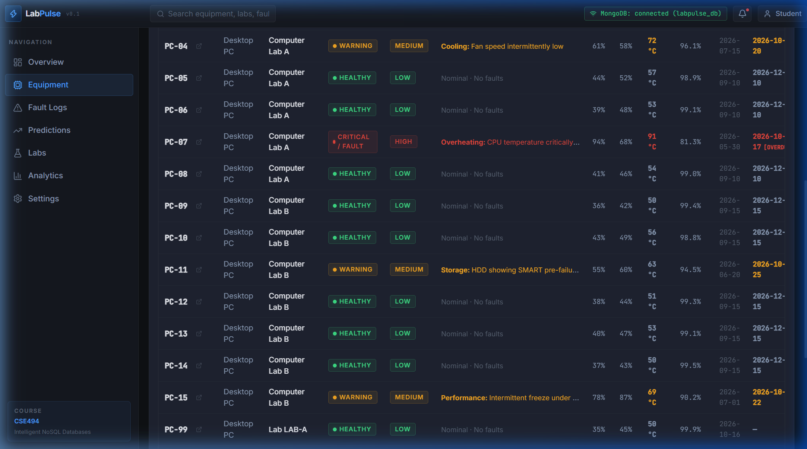
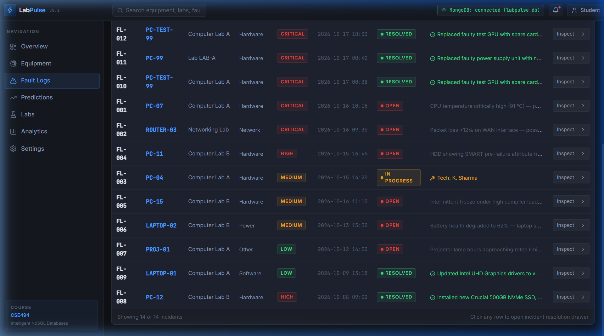
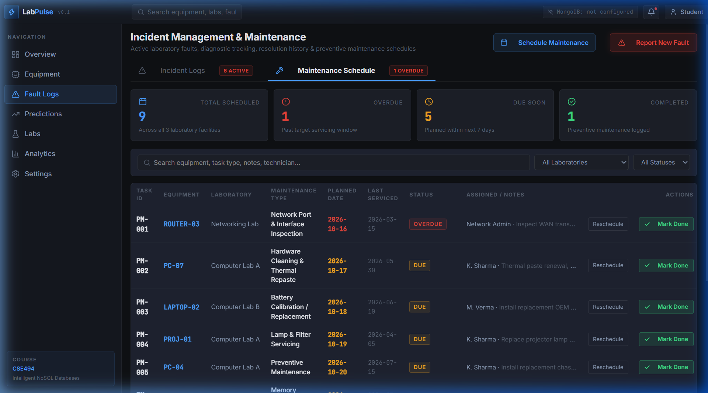
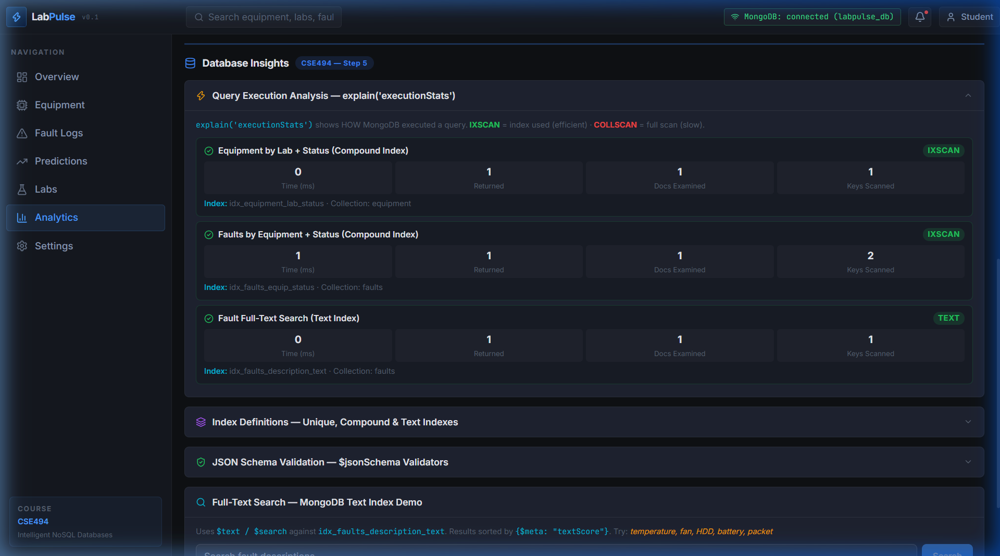
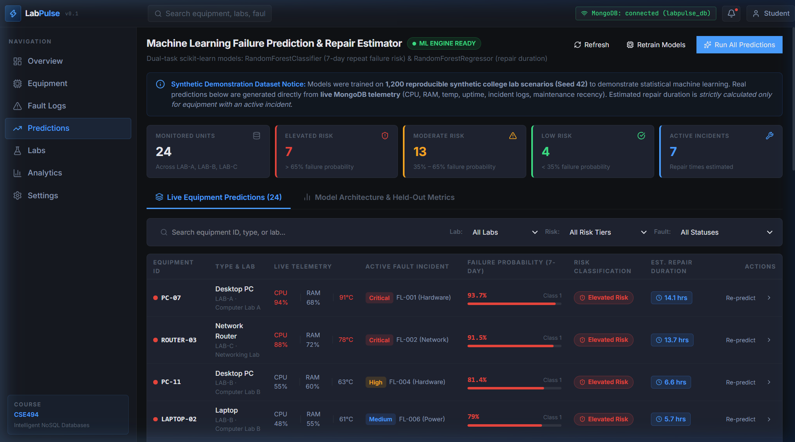
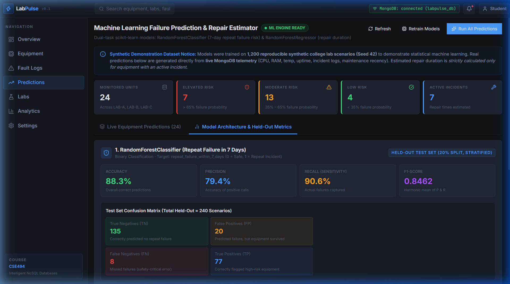

<div align="center">

# ⚡ LabPulse

### Smart Lab Equipment Monitoring, Failure Prediction & 3D Digital Twin Platform

[](https://react.dev/)
[](https://vitejs.dev/)
[](https://tailwindcss.com/)
[](https://threejs.org/)
[](https://www.python.org/)
[](https://flask.palletsprojects.com/)
[](https://www.mongodb.com/)
[](https://scikit-learn.org/)
[](LICENSE)

<br/>

**LabPulse** is an enterprise-grade laboratory equipment monitoring and predictive maintenance platform built for academic computer labs. It pairs an interactive **Three.js 3D Digital Twin** with a high-performance **MongoDB 7.x** document store, a **Python Flask REST API**, and a dual **scikit-learn** machine learning pipeline for real-time failure forecasting and repair estimation.

[Quick Start](#-quick-start) • [Key Features](#-key-features) • [System Architecture](#-system-architecture) • [Database Engineering](#-mongodb-engineering) • [Machine Learning Engine](#-machine-learning-engine) • [API Documentation](#-rest-api-documentation) • [Screenshots](#-visual-gallery)

</div>

---

## 📌 Repository Overview & GitHub Metadata

> **Repository Description for GitHub:**  
> *Enterprise-grade smart laboratory equipment monitoring and predictive maintenance system with 3D Three.js digital twin, MongoDB 7.x schema validation, and scikit-learn failure forecasting.*
>
> **Recommended Repository Topics:**  
> `mongodb` `nosql` `predictive-maintenance` `digital-twin` `threejs` `react` `vite` `flask` `scikit-learn` `machine-learning` `iot-telemetry` `fullstack`

---

## 🚀 Quick Start (One-Command Launch)

You can launch both the **Python Flask REST API Backend** and the **Vite React Frontend** concurrently with **one single command**:

```bash
# Clone the repository
git clone https://github.com/Nikh1lXDev/LabPulse.git
cd LabPulse

# Install frontend dependencies
npm install

# (Optional) Setup python virtual environment and dependencies
pip install -r backend/requirements.txt

# Start all services simultaneously!
npm start
```

*(You can also use `npm run dev` — both launch the unified orchestrator.)*

### Alternative Launch Options:
- **Windows Double-Click:** Run `start.bat` or `run.bat` directly from File Explorer or Command Prompt.
- **PowerShell:** Execute `.\run.ps1`.
- **Python:** Execute `python run.py`.

Once launched, access the platform at:
- 💻 **Frontend Web App:** [http://localhost:5173](http://localhost:5173)
- 📡 **Flask REST API:** [http://localhost:5000](http://localhost:5000)
- 📊 **API Health Check:** [http://localhost:5000/api/health](http://localhost:5000/api/health)

---

## ✨ Key Features

### 🎮 1. Interactive 3D Digital Twin (Three.js)
- **Real-Time Spatial Map:** Visualizes computer laboratory workstations in high-fidelity 3D with realistic lighting, shadows, and orbit controls.
- **Raycasting Tooltips:** Hovering over individual workstations reveals instant live telemetry (CPU temperature, RAM load, network ping, error rates).
- **Status Cues:** Dynamically changes workstation colors based on operating health (`Operational`, `Degraded`, `Offline`, `Maintenance`).

### 🖥️ 2. Centralized Workstation Fleet Registry
- Full inventory registry across computer labs (`LAB-A`, `LAB-B`, `LAB-C`, `LAB-D`).
- Live hardware telemetry simulation (CPU usage, thermals, SSD wear, power consumption).
- Instant multi-field filtering by lab, status, and full-text keyword search.

### 🎫 3. End-to-End Fault Incident Lifecycle
- Formal ticket management workflow (`Reported` ➔ `In Progress` ➔ `Resolved`).
- Priority and severity tracking (`Low`, `Medium`, `High`, `Critical`).
- Automated workstation state transitions: logging a critical fault marks the corresponding workstation as `Degraded` or `Offline` in real time.

### 📅 4. Preventive Maintenance Scheduler
- Scheduled task calendar for routine repasting, dusting, RAM diagnostics, and SSD replacements.
- Status badging (`Scheduled`, `Due`, `Overdue`, `Completed`).
- Historical audit trail recording technician resolution notes and labor hours spent.

### 🧠 5. Predictive Machine Learning Engine
- **Repeat-Failure Risk Classifier (`RandomForestClassifier`):** Predicts the likelihood that a workstation will experience a repeat hardware or software failure within 7 days.
- **Repair-Duration Regressor (`RandomForestRegressor`):** Accurately estimates technician labor hours required to resolve active incidents.
- **Fault-Conditioned Reasoning:** Healthy equipment receives `"Not applicable — no active fault"`, ensuring actionable maintenance schedules.

---

## 🏛️ System Architecture



### High-Resolution Architecture Diagram:
<p align="center">
  
</p>

---

## 🍃 MongoDB Engineering & Implementation

LabPulse implements advanced MongoDB patterns and enterprise features:

### 1. JSON Schema Validation (`$jsonSchema`)
Strict document validation is enforced at the database level for all core collections:
- **`equipment` Collection:** Enforces string patterns for `id` (`^[A-Z0-9_-]+$`), strict enum validation on `status` (`operational`, `degraded`, `offline`, `maintenance`), and schema typing for telemetry subdocuments.
- **`faults` Collection:** Enforces enum severity (`Low`, `Medium`, `High`, `Critical`), category constraints (`Hardware`, `Software`, `Network`, `Power`, `Other`), and ISO date formatting.
- **`maintenance` Collection:** Enforces task types and execution lifecycles.

### 2. Multi-Tier Index Strategy
| Collection | Index Fields | Type | Purpose |
|---|---|---|---|
| `equipment` | `{"id": 1}` | **Unique Single Field** | Guarantees business key uniqueness and $O(1)$ lookups |
| `equipment` | `{"labId": 1, "status": 1}` | **Compound Index** | Optimizes lab-specific status filtering (`IXSCAN`) |
| `faults` | `{"equipId": 1, "status": 1}` | **Compound Index** | Accelerates workstation fault history lookups |
| `faults` | `{"description": "text", "category": "text"}` | **Text Index** | Enables full-text natural language searching (`$text`) |
| `maintenance` | `{"scheduledDate": 1, "status": 1}` | **Compound Index** | Speeds up calendar queries and overdue detection |

### 3. Aggregation Pipelines
Analytical dashboards execute multi-stage aggregations (`$match`, `$group`, `$project`, `$sort`, `$facet`):
- **Fleet Health Breakdown:** Computes percentages of operational vs. degraded assets per laboratory.
- **Incident Severity Distribution:** Aggregates active faults grouped by severity and average resolution time.
- **Query Performance Diagnostics:** Includes an interactive `explain('executionStats')` inspector demonstrating the sub-millisecond efficiency of indexed scans (`IXSCAN`) over unindexed scans (`COLLSCAN`).

---

## 🤖 Machine Learning Engine

The predictive engine runs on **scikit-learn** and is trained on 1,200 curated operational scenarios:

### Model Evaluation Performance (Held-Out Test Split)

| Metric | Repeat-Failure Classifier | Repair-Duration Regressor |
|---|---|---|
| **Model Family** | `RandomForestClassifier` | `RandomForestRegressor` |
| **Accuracy** | **88.33%** | — |
| **Precision** | **79.38%** | — |
| **Recall** | **90.59%** | — |
| **F1-Score** | **0.8462** | — |
| **ROC-AUC** | **0.9575** | — |
| **$R^2$ Score** | — | **0.7054** |
| **Mean Absolute Error (MAE)** | — | **1.39 hours** |

### Key Input Features:
- Workstation age and CPU temperature averages ($\Delta t$)
- Memory utilization and historical fault count
- Current fault severity weighting and category encoding
- Days elapsed since previous preventive maintenance inspection

---

## 📸 Visual Gallery

<div align="center">

### Executive Dashboard & Fleet Telemetry


### Three.js 3D Digital Twin with Interactive Raycasting


### Equipment Inventory Registry


### Incident & Fault Ticket Lifecycle


### Preventive Maintenance Calendar


### MongoDB Aggregation & Index Diagnostics (`explain()`)


### Machine Learning Failure Predictions Dashboard


### Model Confusion Matrix & Precision-Recall Metrics


</div>

---

## 🔌 REST API Documentation

| Method | Endpoint | Description |
|---|---|---|
| `GET` | `/api/health` | System health check, active database ping, and collection statistics |
| `GET` | `/api/equipment` | List equipment with optional `status`, `lab_id`, and `search` filters |
| `POST` | `/api/equipment` | Create new workstation record with `$jsonSchema` validation |
| `PUT` | `/api/equipment/<id>` | Update workstation specifications or live telemetry |
| `DELETE`| `/api/equipment/<id>` | Safely remove equipment with cascade audit logging |
| `GET` | `/api/faults` | Query faults with multi-field filtering and full-text search (`?q=`) |
| `POST` | `/api/faults` | Log a new incident ticket and sync equipment status |
| `PUT` | `/api/faults/<id>` | Update fault resolution status, technician notes, and labor hours |
| `GET` | `/api/maintenance` | Retrieve scheduled preventive maintenance calendar items |
| `POST` | `/api/maintenance` | Schedule new maintenance routine |
| `PUT` | `/api/maintenance/<id>`| Mark maintenance tasks completed with sign-off notes |
| `GET` | `/api/insights/aggregation` | Execute multi-stage analytical aggregation pipelines |
| `GET` | `/api/insights/explain` | Return live `explain('executionStats')` comparing query plans |
| `GET` | `/api/insights/schema` | Inspect active MongoDB schema validation rules |
| `GET` | `/api/insights/indexes` | Catalog all indexes across collections |
| `GET` | `/api/predictions` | Fetch cached failure risk predictions for all workstations |
| `POST`| `/api/predictions/batch`| Execute batch ML inference across all operational units |
| `GET` | `/api/predictions/metrics`| Retrieve serialized model evaluation metrics and confusion matrices |

---

## 🧪 Automated Testing Suite

LabPulse includes a comprehensive backend verification suite covering 9 automated testing domains:

```bash
python backend/test_api.py
```

### Verified Test Domains:
1. Equipment CRUD endpoints and business-key uniqueness
2. Duplicate identifier rejection and error handling
3. Fault incident creation and automatic workstation state synchronization
4. Preventive maintenance lifecycle management
5. MongoDB `$jsonSchema` validation enforcement
6. Index presence and query execution plans (`IXSCAN` verification)
7. Aggregation pipeline aggregation arithmetic correctness
8. Real-time batch machine learning inference stability
9. Model reload and fallback heuristics

---

## 📁 Repository Structure

```text
LabPulse/
├── backend/
│   ├── data/
│   │   ├── labpulse_ml_training.csv      # Synthetic training scenarios (Seed 42)
│   │   └── dataset_metadata.json         # Feature schema and class distributions
│   ├── ml/
│   │   ├── train_models.py               # Model training and validation script
│   │   ├── generate_training_data.py     # Dataset generator script
│   │   └── predictor.py                  # Real-time feature extraction & inference
│   ├── models/
│   │   ├── classifier_pipeline.joblib    # Serialized Random Forest Classifier
│   │   ├── regressor_pipeline.joblib     # Serialized Random Forest Regressor
│   │   └── model_metadata.json           # Model parameters and evaluation metrics
│   ├── reports/
│   │   └── ml_evaluation_results.json    # Authentic confusion matrix and scores
│   ├── .env.example                      # Safe environment variable configuration template
│   ├── app.py                            # Flask REST API server and routing
│   ├── db.py                             # PyMongo layer, schema validation, index creation
│   ├── requirements.txt                  # Python dependencies
│   └── test_api.py                       # Automated backend test suite
├── public/                               # Static assets
├── reports/
│   ├── images/                           # High-resolution screenshots and diagrams
│   ├── build_full_report.py              # Report generation script
│   └── generate_diagram.py               # Architecture diagram generator
├── scripts/
│   └── start.js                          # Unified cross-platform application launcher
├── src/
│   ├── assets/                           # SVG icons and static imagery
│   ├── components/                       # 3D Digital Twin, Modals, Drawers, Charts
│   ├── context/                          # React EquipmentContext with backend sync
│   ├── pages/                            # Overview, Equipment, Faults, Maintenance, Analytics, Predictions
│   ├── App.jsx                           # Application routing container
│   ├── index.css                         # Tailwind CSS styling directives
│   └── main.jsx                          # Frontend entry point
├── .env.example                          # Root environment template
├── .gitignore                            # Comprehensive ignore rules (protects credentials)
├── index.html                            # HTML5 single-page application container
├── LICENSE                               # MIT Open-Source License
├── package.json                          # Node dependencies and scripts
├── run.bat                               # Windows 1-click launcher
├── run.ps1                               # PowerShell launcher
├── run.py                                # Standalone Python launcher
├── start.bat                             # Windows CMD launcher
├── vite.config.js                        # Vite proxy and build configuration
└── README.md                             # Project documentation
```

---

## 📄 License

This project is licensed under the **MIT License** — see the [LICENSE](LICENSE) file for details.

---

<div align="center">
  <b>LabPulse</b> • Built with ❤️ for Smart Laboratory Operations & Intelligent NoSQL Systems
</div>
